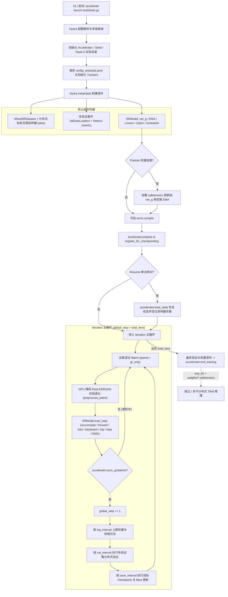
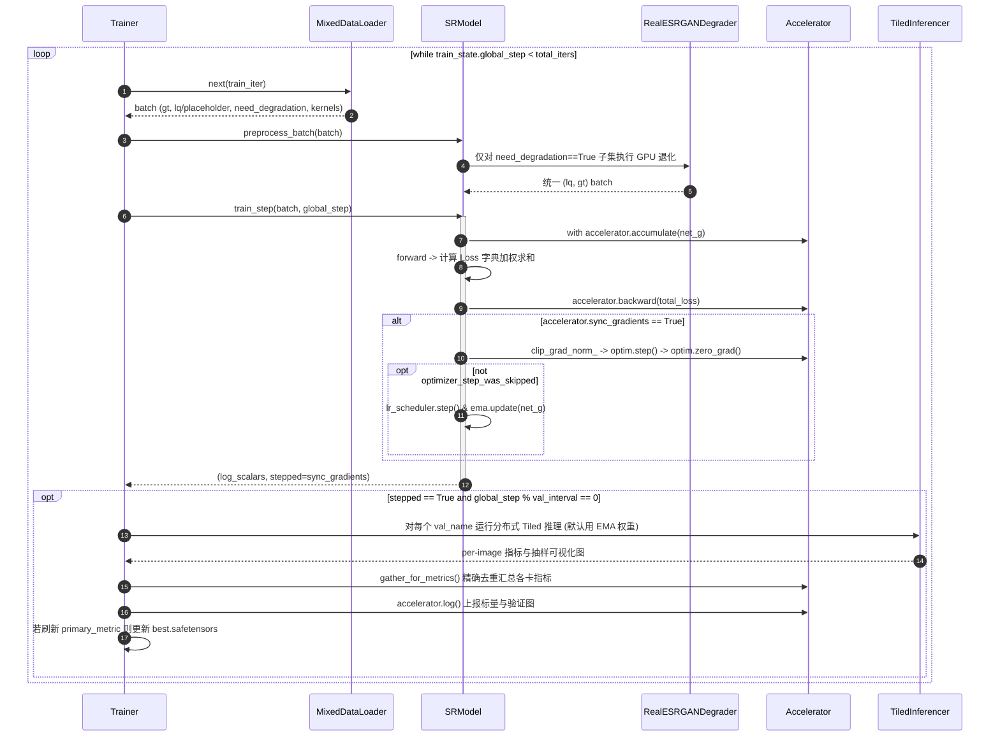
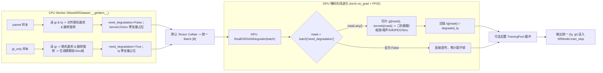

# SRTrainer 架构设计文档

> **定位**：面向图像超分与底层视觉复原（SR / 去噪 / 去模糊 / 图像增强等），基于 **PyTorch + Hugging Face Accelerate + Hydra** 的模块化、可扩展训练与推理框架。
> **设计哲学**：保持 BasicSR 在底层视觉领域的优秀分层直觉，同时全面拥抱 **Accelerate 工程基础设施** 与 **Hydra 原生 `_target_` 组合继承体系**，以最少样板代码实现「训练—验证—续训—分布式推理」全链路 100% 一致。
> **实现范围聚焦（Framework-First）**：当前阶段专注把 SRTrainer 框架主干做扎实（Hydra 分级继承配置、Accelerate `Trainer`、`BaseModel`/`SRModel`/`ModelEMA`、统一 JSON 混合数据集与 GPU 掩码 Real-ESRGAN 退化、`metric` 验证套件与 `meta` 透传、PSNR/SSIM/LPIPS 指标、双轨 Checkpoint、共享 `TiledInferencer` 与 `tools/infer.py` 分布式推理）。网络与损失函数保持最小克制：`src/archs/` 仅提供轻量占位网络 **`ToyModel`**（`src/archs/toy_model.py`，对应 `configs/arch/toy_x4.yaml`），`src/losses/` 仅内置 **`L1Loss`** 与 **`LPIPSLoss`**，用户可随时通过 Hydra `_target_` 自由接入自定义网络与损失函数。

---

## 1. 核心设计决策总览

| 维度 | 最终设计方案 | 核心考量 |
| :--- | :--- | :--- |
| **任务边界** | 聚焦图像超分与底层视觉复原，基类保持弱耦合以兼容后续 Video SR / Diffusion SR | 精准解决底层视觉痛点（退化、tile、Y 通道指标），不过度泛化 |
| **核心分层** | **分层混合架构**：`Trainer` 持有 `Accelerator` 管外层循环与基础设施；`BaseModel` 管网络/Loss/优化器/EMA 与单步前反向 | 基础设施与算法逻辑解耦；第一版聚焦 `SRModel`，未来扩展 `SRGANModel` / `DiffusionSRModel` 无需改动 `Trainer` |
| **组件实例化** | **纯 Hydra `_target_` + `hydra.utils.instantiate`**（配合 `_partial_: true` 与包级 `__init__.py` 短路径重导出） | 零框架侵入、免去 Registry 装饰器与自动扫描维护成本，无缝接入 PyTorch / `timm` / `diffusers` |
| **配置组织** | **模块化配置组 + `experiment/` 多级继承**（纯 YAML + `# @package _global_`） | 兼顾模块复用、多级实验继承与快速修改局部参数 |
| **训练调度** | **纯 Iteration 驱动**（`total_iters` 为唯一主轴，无限循环 DataLoader，`global_step` 严格按 `sync_gradients` 递增） | 对齐超分领域习惯，天然适配梯度累积与任意体量数据集混合 |
| **Accelerate 范围** | 单卡 / 多卡 DDP 核心（`bf16/fp16`、梯度累积、梯度裁剪、`torch.compile`、EMA），接口遵循 `save_state` / `get_state_dict` 规范 | 开箱稳定，同时为未来扩展 FSDP / DeepSpeed 留好标准契约 |
| **数据流水线** | 仅独立图片文件（jpg/png）+ 统一字典列表 JSON 清单；配置指定 JSON 列表、`root_dir` 与采样 `ratio`（自动根据 JSON 是否含 `lq` 判定退化）；**样本级混合 `MixedSRDataset` + GPU 掩码 Real-ESRGAN 退化** | 单组 DataLoader worker 即可实现 `GT-only` 与 `LQ+GT` 严格按比例平滑混合，无需手工标注 `mode` |
| **验证与指标** | 验证集统一在 `metric` 配置组中按套件管理（支持不同验证集绑定各自指标与 JSON 附加字段透传，如 OCR-A 的 `label`）；Accelerate 分布式精确评估（`gather_for_metrics` 去重）；内置 **PSNR / SSIM / LPIPS**，支持 `BaseMetric` 扩展 | 适配需要额外标注输入的多样化评测指标；验证与推理共享同一底层 `TiledInferencer` |
| **Checkpoint** | **双轨保存**：滚动 `accelerator.save_state()`（精确续训）+ 轻量 `safetensors` 纯模型权重（含 `net_g`/`net_g_ema` 与 `best`）+ 持久化 `config_resolved.yaml` | 同时满足精确断点续训、轻量推理部署与二阶段微调加载 |
| **日志追踪** | 统一走 Accelerate `log_with` / `init_trackers`（支持 YAML 切换或多 tracker 并行）+ Rank 0 本地终端/文件日志 | 不绑定单一实验看板，TensorBoard / WandB / SwanLab / MLflow 即插即用 |
| **推理架构** | 仅通过 `tools/infer.py` 提供推理入口（支持**实验目录自动还原 + 独立 `infer.yaml` 双配置模式**）；支持 **Accelerate 多卡分布式离线推理**；支持 **按训练输入尺寸自动推导 `tile_size` + 可配置 `overlap` 无缝融合** | 杜绝训练/推理配置漂移，接口克制聚焦，解决大模型大图推理 OOM 与感受野偏移 |

---

## 2. 全流程架构与执行时序

### 2.1 端到端系统全流程



### 2.2 单步训练与分布式验证交互时序



---

## 3. 工程目录结构

采用扁平 `src` 源码根目录布局，配合 `pyproject.toml` + `uv sync` 可编辑安装，使任意路径下都能直接通过 `archs.*`、`models.*`、`losses.*` 等顶层包引用 `_target_`。

```text
SRTrainer/
├── pyproject.toml                       # 依赖声明、UV 配置与工具配置 (ruff/pytest)
├── uv.lock                              # UV 锁定的跨平台依赖版本
├── .python-version                      # UV 默认 Python 版本声明
├── docs/
│   └── design.md                        # 本文档
├── configs/                             # Hydra 分级配置根目录
│   ├── train.yaml                       # 训练主入口配置
│   ├── infer.yaml                       # 推理主入口配置
│   ├── arch/                            # 网络结构原子配置（仅保留轻量占位配置）
│   │   └── toy_x4.yaml
│   ├── loss/                            # 损失函数组合配置（仅内置 L1Loss 与 LPIPSLoss）
│   │   ├── l1.yaml
│   │   └── l1_lpips.yaml
│   ├── model/                           # 训练范式配置
│   │   └── sr.yaml
│   ├── data/                            # 训练数据集与在线退化配置
│   │   ├── mixed_sr_x4.yaml
│   │   └── degradation/
│   │       └── realesrgan_2nd.yaml
│   ├── optim/                           # 优化器与学习率调度配置
│   │   ├── adamw_cosine.yaml
│   │   └── adam_multistep.yaml
│   ├── metric/                          # 验证集套件与评测指标组合配置（含各验证集数据源与对应指标）
│   │   └── sr_default.yaml
│   ├── trainer/                         # Trainer / Accelerate / 日志 / 保存配置
│   │   └── default.yaml
│   ├── infer/                           # 推理切块与分布式配置
│   │   └── default.yaml
│   └── experiment/                      # 实验配置层（支持多级继承与局部微调）
│       ├── base_sr_x4.yaml
│       └── exp01_toy_mixed_x4.yaml
├── src/
│   ├── engine/                          # 训练/验证/推理引擎层
│   │   ├── __init__.py
│   │   ├── trainer.py                   # Trainer：外层循环、验证、Checkpoint、Tracker
│   │   ├── state.py                     # TrainState（注册到 Accelerate checkpoint）
│   │   ├── checkpointer.py              # 双轨保存（save_state + safetensors + best）
│   │   └── inferencer.py                # TiledInferencer（验证阶段与 tools/infer.py 共享）
│   ├── models/                          # 算法范式层（通过 Hydra _target_ 实例化）
│   │   ├── __init__.py                  # 重导出 BaseModel, SRModel, ModelEMA
│   │   ├── base_model.py                # 抽象基类（预留多网络/多优化器/Diffusion 扩展点）
│   │   ├── sr_model.py                  # 第一版主力：单网络 + Loss字典 + EMA + GPU退化
│   │   └── ema.py                       # 可注册到 Accelerate Checkpoint 的 ModelEMA
│   ├── archs/                           # 神经网络结构（纯 PyTorch nn.Module，占位实现）
│   │   ├── __init__.py                  # 短路径重导出：archs.ToyModel
│   │   └── toy_model.py                 # 轻量占位超分网络 ToyModel
│   ├── losses/                          # 损失函数模块（纯 PyTorch nn.Module，仅内置 L1 与 LPIPS）
│   │   ├── __init__.py                  # 重导出 L1Loss, LPIPSLoss
│   │   ├── pixel_loss.py                # L1Loss
│   │   └── perceptual_loss.py           # LPIPSLoss
│   ├── data/                            # 数据管线与退化模块
│   │   ├── __init__.py
│   │   ├── manifest.py                  # 统一 JSON 清单解析与自动类型检测（是否含 lq / gt）
│   │   ├── mixed_dataset.py             # MixedSRDataset（自动识别 gt_only 与 paired 并混合）
│   │   ├── val_dataset.py               # ValImageDataset（自动检测 gt，透传 JSON 全部附加字段到 meta）
│   │   ├── sampler.py                   # DistributedWeightedInfiniteSampler（支持精确 resume）
│   │   ├── transforms.py                # 配对随机裁剪、翻转、旋转与归一化
│   │   └── degradation/
│   │       ├── __init__.py
│   │       ├── kernels.py               # CPU 模糊核 & Sinc 核生成
│   │       ├── diffjpeg.py              # GPU 可微/批量 JPEG 压缩模拟
│   │       └── realesrgan.py            # RealESRGANDegrader（支持样本级掩码退化 & 可选 Pool）
│   ├── metrics/                         # 评测指标模块
│   │   ├── __init__.py                  # 重导出 PSNRMetric, SSIMMetric, LPIPSMetric
│   │   ├── base.py                      # BaseMetric 抽象协议（支持 pred / target / meta 附加输入）
│   │   ├── psnr_ssim.py                 # 对齐 BasicSR 的 crop_border / Y 通道 PSNR & SSIM
│   │   └── lpips_metric.py              # 设备复用式 LPIPS 指标
│   └── utils/                           # 通用工具
│       ├── __init__.py
│       ├── config.py                    # Hydra 解析、Rank 0 广播目录与 config_resolved 读写
│       ├── image.py                     # 图像 I/O（jpg/png <-> RGB float32 tensor）、拼接对比图
│       ├── logging.py                   # Rank 0 终端/文件 Logger 与 ETA/显存统计
│       └── misc.py                      # 权重加载（strict/ema/key 映射）、pad_to_multiple 等
├── tools/
│   ├── train.py                         # 训练入口脚本
│   └── infer.py                         # 单卡/多卡推理入口脚本
└── tests/                               # 单元测试与端到端冒烟测试
    ├── test_hydra_configs.py
    ├── test_mixed_dataset.py
    ├── test_degrader.py
    ├── test_tiled_inferencer.py
    └── test_train_smoke.py
```

> **包级重导出约定**：在 `src/archs/__init__.py`、`src/losses/__init__.py` 等处显式导出公共类，使 Hydra YAML 中只需写 `_target_: archs.ToyModel`、`_target_: losses.L1Loss` 等，既简洁又不因内部文件名重构而失效。

---

## 4. Hydra 分级配置与多级继承设计

### 4.1 配置组合与继承层级

Hydra 配置按职责拆分为 **原子模块层 → 入口组装层 → 实验继承层 → CLI 临时覆盖层**，优先级由低到高：

```text
[1] configs/{arch,loss,model,data,optim,metric,trainer}/*.yaml   (原子配置块)
       ↓  组合
[2] configs/train.yaml                                           (默认训练基线)
       ↓  # @package _global_ 继承与 override
[3] configs/experiment/base_sr_x4.yaml                           (任务公共基线实验)
       ↓  多级继承（仅写 3~5 行差异）
[4] configs/experiment/exp01_toy_mixed_x4.yaml                   (具体实验配置)
       ↓  运行时临时覆盖
[5] CLI 参数 (trainer.total_iters=50000 optim.optimizer.lr=1e-4)
```

### 4.2 关键 YAML 示例

#### ① 主入口：`configs/train.yaml`
```yaml
defaults:
  - arch: toy_x4
  - loss: l1
  - model: sr
  - data: mixed_sr_x4
  - optim: adamw_cosine
  - metric: sr_default
  - trainer: default
  - _self_                # 置于 experiment 之前，确保 experiment 覆盖主入口默认值
  - experiment: null      # 放在后面，确保 experiment 覆盖前面所有默认组与主入口标量
  - override hydra/job_logging: disabled

# 全局公共变量（供各模块通过 ${...} 插值引用，保持一处修改全局同步）
exp_name: debug_sr_x4
scale: 4
seed: 42
output_root: experiments
work_dir: ${output_root}/${exp_name}

# 禁止 Hydra 自动 chdir，并接管日志目录，避免多卡 accelerate launch 时不同 rank 目录错位
hydra:
  job:
    chdir: false
  run:
    dir: ${work_dir}
  output_subdir: null     # 由 Trainer 在 Rank 0 统一保存 config_resolved.yaml
```

#### ② 原子模块示例：`configs/arch/toy_x4.yaml`、`configs/loss/l1_lpips.yaml`、`configs/optim/adamw_cosine.yaml`
```yaml
# configs/arch/toy_x4.yaml
_target_: archs.ToyModel
num_in_ch: 3
num_out_ch: 3
num_feat: 32
num_block: 2
scale: ${scale}
```

```yaml
# configs/loss/l1_lpips.yaml
# Loss 采用“命名权重字典”组织，内置 L1Loss 与 LPIPSLoss，便于自动记录各项子 Loss 曲线并灵活扩展
l1:
  weight: 1.0
  criterion:
    _target_: losses.L1Loss
    reduction: mean
lpips:
  weight: 0.1
  criterion:
    _target_: losses.LPIPSLoss
    net: alex
    pretrained: true
```

```yaml
# configs/optim/adamw_cosine.yaml
# 使用 Hydra _partial_: true，将 params / optimizer 留到模型构建时自动注入
optimizer:
  _target_: torch.optim.AdamW
  _partial_: true
  lr: 2.0e-4
  betas: [0.9, 0.99]
  weight_decay: 0.0

scheduler:
  _target_: torch.optim.lr_scheduler.CosineAnnealingLR
  _partial_: true
  T_max: ${trainer.total_iters}
  eta_min: 1.0e-6
```

#### ③ 实验多级继承示例：`configs/experiment/base_sr_x4.yaml` → `exp01_toy_mixed_x4.yaml`
```yaml
# configs/experiment/base_sr_x4.yaml
# @package _global_
defaults:
  - override /arch: toy_x4
  - override /data: mixed_sr_x4
  - override /loss: l1
  - override /optim: adamw_cosine
  - _self_

scale: 4
trainer:
  total_iters: 300000
  val_interval: 5000
  save_interval: 5000
  mixed_precision: bf16
  gradient_accumulation_steps: 1
```

```yaml
# configs/experiment/exp01_toy_mixed_x4.yaml
# @package _global_
defaults:
  - /experiment/base_sr_x4        # 直接继承公共基线实验！
  - override /loss: l1_lpips      # 替换 Loss 组
  - _self_

# 在继承基础上快速修改少数关键配置
exp_name: exp01_toy_l1_lpips_x4
arch:
  num_feat: 16
optim:
  optimizer:
    lr: 1.0e-4
loss:
  lpips:
    weight: 0.05                  # 局部覆写单个 Loss 权重
trainer:
  total_iters: 200000
```

#### ④ 命令行使用方式
```bash
# 运行继承实验，并在 CLI 再临时改 2 个参数
accelerate launch tools/train.py \
  experiment=exp01_toy_mixed_x4 \
  optim.optimizer.lr=5e-5 \
  trainer.log_with='[tensorboard,wandb]'

# 自动从最近一次状态续训
accelerate launch tools/train.py \
  experiment=exp01_toy_mixed_x4 \
  trainer.resume=auto
```

> **多卡启动防坑设计**：Hydra 默认按时间戳建目录，多卡启动可能因跨秒导致不同 Rank 路径不一致。本框架显式关闭 `hydra.job.chdir` 与 `output_subdir`，以确定性 `${work_dir}`（或在启用时间戳后缀时由 Rank 0 生成并通过 `accelerate.utils.broadcast_object_list` 广播给所有 Rank）作为唯一输出目录，且仅由 Rank 0 写入 `config_resolved.yaml`。

---

## 5. 核心引擎与 Model 抽象设计

### 5.1 `BaseModel` 与 `SRModel` 接口契约

`BaseModel` 负责封装一切**与算法范式强相关**的对象与单步逻辑，`Trainer` 只与 `BaseModel` 的抽象契约交互。第一版专注实现 `SRModel`，但所有接口均以列表/字典语义预留多网络与多优化器扩展能力（未来新增 `SRGANModel` 或 `DiffusionSRModel` 时 `Trainer` 零修改）。

```python
class BaseModel(ABC):
    """所有训练范式的抽象基类。"""

    def __init__(self, cfg: DictConfig) -> None: ...

    @abstractmethod
    def setup(self, accelerator: Accelerator) -> None:
        """
        核心生命周期顺序（严格防踩坑）：
        1. 实例化原始网络 net_g / Losses / Degrader
        2. 如配置了 pretrain_path，加载纯权重到原始 net_g（支持 strict 与 key 映射）
        3. 若启用 EMA，从初始化完成的 net_g 深度克隆 FP32 EMA 模型
        4. 如启用 torch.compile，在此处编译原始 net_g
        5. 实例化 partial optimizer 与 lr_scheduler
        6. 调用 accelerator.prepare(net_g, optimizer)
           注意：纯 Iteration 模式下不把 lr_scheduler 传入 prepare()，
           避免 Accelerate 自动按 num_processes 倍速步进；改为手动 register_for_checkpointing!
        7. 调用 accelerator.register_for_checkpointing(lr_scheduler) 与 ema（若启用）
        """

    def preprocess_batch(self, batch: dict[str, Any]) -> dict[str, Any]:
        """GPU 侧 batch 预处理钩子（如 Real-ESRGAN 掩码在线退化）。默认透传。"""
        return batch

    @abstractmethod
    def train_step(self, batch: dict[str, Any], global_step: int) -> tuple[dict[str, float], bool]:
        """
        执行一次 micro-step 前向/反向；仅在 accelerator.sync_gradients==True 时执行：
        - 梯度裁剪 (accelerator.clip_grad_norm_)
        - optimizer.step() & optimizer.zero_grad()
        - 若 not accelerator.optimizer_step_was_skipped: lr_scheduler.step() & ema.update()
        返回: (各子 loss/lr/grad_norm 标量字典, stepped=accelerator.sync_gradients)
        """

    @abstractmethod
    def get_infer_network(self, use_ema: bool = True) -> nn.Module:
        """返回验证/推理使用的网络（EMA 优先，否则返回主网络）。"""

    @abstractmethod
    def export_weights(self, accelerator: Accelerator) -> dict[str, dict[str, torch.Tensor]]:
        """
        通过 accelerator.get_state_dict() 提取干净的推理权重字典（兼容 DDP & 未来 FSDP）：
        返回例如 {"net_g": state_dict, "net_g_ema": ema_state_dict}。
        """

    def get_lr_dict(self) -> dict[str, float]:
        """返回当前学习率字典用于日志上报。"""
```

### 5.2 `SRModel` 的核心细节

1. **任意可组合 Loss 字典**：遍历 `cfg.loss`，框架内置 `L1Loss` 与 `LPIPSLoss`，同时支持用户通过 Hydra `_target_` 自由扩展任意自定义 Loss，自动记录每个分项的原始值与加权总值（`loss/l1`、`loss/lpips`、`loss/total`），跳过 `weight <= 0` 的项。
2. **Accelerate + `lr_scheduler` 关键规范**：
   - 在 Accelerate 中，若将 `lr_scheduler` 传给 `accelerator.prepare()`，Accelerate 默认会在每步按 `num_processes` 倍调用 `scheduler.step()`，极易导致多卡时学习率提前衰减到 0。
   - 因此本框架对 Iteration 级 `lr_scheduler` **不传入 `prepare()`**，而是直接通过 `accelerator.register_for_checkpointing(lr_scheduler)` 纳入断点保存，并在 `sync_gradients and not accelerator.optimizer_step_was_skipped` 时精确步进 1 次（FP16 出现梯度溢出跳过 step 时也不会错误推进 LR！）。
3. **ModelEMA 设计**：
   - 维护 FP32 阴影权重副本，支持 `decay`（默认 `0.999`）与可选前期 warmup decay（防止前几千步 EMA 滞后）；
   - 实现 `state_dict()` / `load_state_dict()` 并注册到 `accelerator.register_for_checkpointing(ema)`，确保断点续训时 EMA 权重 100% 连续。

### 5.3 `Trainer` 外层循环与 `TrainState`

```python
@dataclass
class TrainState:
    """注册到 accelerator.register_for_checkpointing，确保续训精确恢复。"""
    global_step: int = 0
    best_metrics: dict[str, float] = field(default_factory=dict)

    def state_dict(self) -> dict[str, Any]: ...
    def load_state_dict(self, state: dict[str, Any]) -> None: ...
```

**`Trainer` 关键职责**：
- 初始化 `Accelerator(mixed_precision=..., gradient_accumulation_steps=..., log_with=..., project_config=...)`；
- 在 Rank 0 上创建实验目录结构并持久化解析后的 `config_resolved.yaml`；
- 构建 `MixedSRDataset` + `DistributedWeightedInfiniteSampler`（直接按 `rank`/`world_size` 切分，**不**交由 `accelerator.prepare(train_loader)` 篡改自定义加权采样器）；
- 若配置 `resume: auto`（自动定位 `checkpoints/` 下最新 `state_iter_*`）或显式路径，调用 `accelerator.load_state()` 恢复全部训练态，并将采样器精确快进至 `train_state.global_step`；
- 执行纯 Iteration 主循环：仅在 `stepped == True` 时推进 `global_step += 1`，按 `log_interval` / `val_interval` / `save_interval` 分别触发标量汇总日志、多验证集分布式评估、双轨 Checkpoint 保存。

---

## 6. 数据流水线与混合退化设计

### 6.1 统一 JSON 清单格式与自动模式检测

仅使用独立图像文件（`.jpg` / `.png` / `.jpeg` / `.webp`），所有数据源统一采用**对象列表（List of Dicts）** JSON 格式记录相对路径；框架在读取样本时**自动根据是否包含有效 `lq` 字段判断模式**，配置中无需手写 `mode`：

- **`gt_only` JSON 示例**（无 `lq` 字段，自动标记 `need_degradation = True`）：
  ```json
  [
    {"gt": "DIV2K_train_HR/0001.png"},
    {"gt": "DIV2K_train_HR/0002.png"}
  ]
  ```
- **`paired` JSON 示例**（同时含 `gt` 与 `lq` 字段，自动标记 `need_degradation = False`）：
  ```json
  [
    {"gt": "hr/0001.png", "lq": "lr_x4/0001.png"},
    {"gt": "hr/0002.png", "lq": "lr_x4/0002.png"}
  ]
  ```

> **自动检测与启动校验规则**：
> - 样本级自动检测：`lq` 字段不存在或为 `null`/空字符串 → `gt_only`（走 GPU 在线退化）；`lq` 字段有效 → `paired`（直接读取成对图像）。天然支持纯 `gt_only`、纯 `paired`，甚至单个 JSON 内混排两类样本；
> - 启动时在 Rank 0 打印各数据源的自动检测统计（如 `[Data] df2k_gt: 3450 samples (gt_only: 3450, paired: 0)`），若存在任何 `gt_only` 样本但未配置 `degradation`，立即报错 fail-fast。

#### 训练数据集 Hydra 配置：`configs/data/mixed_sr_x4.yaml`

> `configs/data/` 仅负责**训练数据与在线退化**；验证集与对应评测指标统一在 `configs/metric/` 中配置（见第 7 节）。

```yaml
gt_size: 256                  # 训练 GT 裁剪尺寸；LQ 输入尺寸自动为 gt_size // scale (= 64)
scale: ${scale}
batch_size_per_gpu: 8
num_workers: 8
pin_memory: true
persistent_workers: true

# 训练数据源列表：无需写 mode，自动从 JSON 检测；ratio 自动归一化
sources:
  - name: df2k_gt
    root_dir: /data/DF2K
    json_path: /data/manifests/df2k_gt.json
    ratio: 0.7
  - name: biz_real_paired
    root_dir: /data/BizReal
    json_path: /data/manifests/biz_real_paired.json
    ratio: 0.3

augment:
  hflip: true
  vflip: true
  rot90: true

degradation:
  _target_: data.degradation.RealESRGANDegrader
  scale: ${scale}
  use_usm: false            # 可选 GT USM 锐化
  queue_size: 0             # 可选训练 Pool（0 表示关闭；>0 时必须是 batch_size 整数倍）
  # 二阶退化超参（模糊核/缩放/高斯泊松噪声/JPEG/Sinc 等参数省略）
  kernel_cfg:
    kernel_size: 21
    blur_sigma: [0.2, 3.0]
    blur_sigma2: [0.2, 1.5]
    sinc_prob: 0.1
    sinc_prob2: 0.8
  # ...
```

### 6.2 `DistributedWeightedInfiniteSampler`（严格按比例 + 精确 Resume）

为满足**采样比例与数据集原始体量解耦**、**多卡无重叠分片**以及 **O(1) 断点续训定位**，采样器设计如下：
1. 将所有数据源的 `ratio` 归一化为概率分布 $p = (p_1, \dots, p_K)$；
2. 每次产出逻辑全局步 `micro_step` 所需的 `world_size * batch_size_per_gpu` 个二元组 `(source_id, sample_idx)`：
   - 使用确定性种子 `seed_step = base_seed + micro_step` 初始化局部生成器 `np.random.Generator`；
   - 按概率 $p$ 抽取 `source_id`，再在对应数据源内随机抽取 `sample_idx`；
   - 当前进程 `rank` 仅切取属于自己的切片 `[rank :: world_size]` 返回给 DataLoader；
3. **断点续训**：恢复到 `global_step` 时，直接令 `start_micro_step = global_step * grad_accum_steps`，无需遍历跳过历史 batch，耗时 O(1) 且数据流完全可复现。

### 6.3 样本级混合 + GPU 掩码 Real-ESRGAN 退化



**关键实现细节**：
- **数值精度保护**：GPU 在线退化强制在 `torch.no_grad()` 与 `torch.amp.autocast(enabled=False)`（FP32）下执行，防止 `bf16/fp16` 下 DiffJPEG DCT 变换或泊松噪声出现精度损失或 NaN；
- **尺寸自检**：对 `paired` 样本在读取后严格校验 `gt_h == lq_h * scale` 且 `gt_w == lq_w * scale`，裁剪坐标严格按 `lq_top * scale` 对齐，杜绝亚像素偏移；
- **可选 TrainingPool**：若启用 `queue_size > 0`，Pool 放在**掩码退化之后**缓存 `(lq, gt)` 对，既增加 batch 内退化多样性，又保持混合比例不失真。

---

## 7. 多验证集分布式评估与可扩展指标体系

### 7.1 验证集内聚于 `metric` 配置与附加字段透传

不同的验证任务往往需要**不同的评测指标集合以及额外的标注输入**（例如常规画质基准需要 `lq + gt` 计算 PSNR/SSIM/LPIPS，而文字超分评测 **OCR-A** 还需要样本的文本 `label` 标注；无参考真实集甚至没有 `gt`）。因此，**所有验证集不在 `configs/data/` 中配置，而是统一作为验证套件（`val_suites`）配置在 `configs/metric/` 中**，将“验证数据源 + 所需指标”自然绑定。

验证集 JSON 清单同样采用统一的对象列表格式，自动检测 `gt` 是否存在，并将除 `lq`/`gt` 之外的**全部附加字段透传到 `meta` 字典**：
```json
[
  {"lq": "lr/0001.png", "gt": "hr/0001.png", "label": "HELLO 2026"},
  {"lq": "lr/0002.png", "label": "SRTRAINER"}
]
```
- `ValImageDataset` 读取 `lq`（必需）与 `gt`（按 JSON 自动检测，无则置 `None`），并把其余字段（如 `label`）及解析后的 `lq_path`/`gt_path` 打包为 `meta`；
- 配合专用的 `val_collate_fn`（面向 `batch_size=1`），完整保留 `meta` 的原始 Python 字典结构（避免 PyTorch 默认 collate 破坏变长字符串/嵌套字段/`None` 值）。

### 7.2 分布式精确聚合机制

多卡验证常见陷阱：标准 `DistributedSampler` 会在样本数不能被 `num_processes` 整除时重复补齐尾部样本，直接求平均会导致指标偏差。

本框架验证流程：
1. 遍历 `cfg.metric.val_suites` 中的每个验证套件，为其构建 `ValImageDataset`（验证图分辨率不一，默认 `batch_size=1`）并交由 `accelerator.prepare(val_loader)` 自动完成分布式切分（区别于训练集的自定义加权无限采样器）；
2. 每张图统一调用共享的 `TiledInferencer.infer_tensor(lq)`（支持自动 `tile_size` 与 `pad_to_multiple`，确保验证和最终部署推理结果比特级一致）；
3. 在 `for batch in val_loader:` 循环内逐 step 调用该验证套件绑定的各项指标 `metric.compute_stats(pred, target=gt, meta=meta)`（默认回退为 `(compute(...), 1.0)`），将每样本统计量组装为 `[1, 2]` 张量直接调用 **`accelerator.gather_for_metrics()`**（首维为样本维，Accelerate 在最后一步按余数同时裁剪补齐样本的分子与分母），循环结束后汇总全局分子与分母求比值（总分母为 `0` 时返回 `NaN`，跳过 best 更新）；
4. 可视化存图：每个验证套件支持配置 `max_save_images`（默认继承全局设置），仅对命中的样本在本地保存 `LQ_bicubic | SR | GT` 拼接图（无 GT 时保存 `LQ_bicubic | SR`）或单图，并同步写入 Accelerate Tracker。

### 7.3 可扩展指标协议（`BaseMetric`）

所有指标均遵循统一抽象协议，用户新增指标（如 `OCR-A`、人脸相似度等）只需继承 `BaseMetric` 并在 YAML 中配置 `_target_` 即可无缝接入：

```python
class BaseMetric(ABC):
    """评测指标统一协议。"""
    higher_is_better: bool = True

    @abstractmethod
    def compute(
        self,
        pred: torch.Tensor,
        target: torch.Tensor | None = None,
        meta: dict[str, Any] | None = None,
    ) -> float:
        """
        Args:
            pred: 模型输出 RGB 张量，形状 [1, 3, H, W]，值域 [0, 1]
            target: GT RGB 张量，形状 [1, 3, H, W]，值域 [0, 1]（若该验证样本 JSON 无 gt 则为 None）
            meta: JSON 清单中该样本透传的全部附加字段（如 OCR-A 所需的 label、以及 lq_path/gt_path 等）
        Returns:
            单图指标标量（float）
        """
    def compute_stats(
        self,
        pred: torch.Tensor,
        target: torch.Tensor | None = None,
        meta: dict[str, Any] | None = None,
    ) -> tuple[float, float]:
        """返回可加和的 (numerator, denominator) 统计量用于全局加权归约；默认返回 (compute(...), 1.0)。"""
```

**内置指标**：
- `PSNRMetric`：支持 `crop_border`（默认 `scale`）与 `test_y_channel`（严格对齐 BasicSR / MATLAB ITU-R BT.601 Y 通道转换公式）；
- `SSIMMetric`：支持 `crop_border` 与 `test_y_channel`，11×11 高斯窗；
- `LPIPSMetric`（`higher_is_better = False`）：初始化时在当前卡仅加载一次权重并置于 `eval()` + `no_grad()`，复用显存不重复加载；
- **文本 OCR 指标**（`src/metrics/ocr_metrics.py`，配置示例见 `configs/metric/text_ocr.yaml`，详细合同见 `docs/ocr_metrics_design.md`）：
  - `OCRAccuracyMetric`（**OCR-A**，`higher_is_better = True`）、`CERMetric`（**CER**，`higher_is_better = False`，不截断允许 `> 1`）、`OneMinusNEDMetric`（**1-NED**，`higher_is_better = True`）；
  - 与 `yqwu905/VOSR` `evaluate.py` 对齐 NFKC/空白规范化、Unicode 单位代价 Levenshtein 编辑距离与 OpenCV `INTER_CUBIC` / `BORDER_REPLICATE` 透视裁剪（高宽比 `>= 1.5` 逆时针旋转 90°）；
  - 支持单行整图 `label` 与多框 `text_lines`（`points`/`quad`/`bbox`/`box` + 可选 `annotation_size` 显式缩放），不依赖 `target`（支持 GT-less）；
  - 延迟导入可选依赖（`uv sync --extra ocr`），默认 `ocr_device="cpu"`（`.to(torch_device)` 安全空操作），同进程同配置三指标共享模型并有界缓存最后一个样本的一次识别结果；多进程运行前建议单进程预下载权重并统一配置只读本地 `ocr_model_dir`。

#### 验证套件与指标 Hydra 配置：`configs/metric/sr_default.yaml`
```yaml
primary_dataset: set5         # 用于判定 best 权重的基准验证套件名
primary_metric: psnr          # 用于判定 best 权重的主指标名

val_suites:
  set5:
    dataset:
      root_dir: /data/benchmarks/Set5
      json_path: /data/manifests/set5_x4.json
    metrics:
      psnr:
        _target_: metrics.PSNRMetric
        crop_border: ${scale}
        test_y_channel: true
      ssim:
        _target_: metrics.SSIMMetric
        crop_border: ${scale}
        test_y_channel: true
      lpips:
        _target_: metrics.LPIPSMetric
        net: alex

  urban100:
    dataset:
      root_dir: /data/benchmarks/Urban100
      json_path: /data/manifests/urban100_x4.json
    metrics:
      psnr:
        _target_: metrics.PSNRMetric
        crop_border: ${scale}
        test_y_channel: true
      ssim:
        _target_: metrics.SSIMMetric
        crop_border: ${scale}
        test_y_channel: true

  # 自定义附加输入指标示例（如 OCR-A，通过 JSON 中的 label 字段传入 meta）：
  # text_ocr_val:
  #   dataset:
  #     root_dir: /data/benchmarks/TextOCR
  #     json_path: /data/manifests/text_ocr_val.json  # [{"lq": "...", "gt": "...", "label": "ABC"}]
  #   metrics:
  #     ocr_a:
  #       _target_: my_project.metrics.OCRAMetric
  #       label_key: label
```

---

## 8. 双轨 Checkpoint、续训与实验目录规范

### 8.1 实验输出目录布局

```text
experiments/exp01_toy_l1_lpips_x4/
├── config_resolved.yaml                 # Rank 0 保存的完全解析后配置（供推理自动还原）
├── train.log                            # Rank 0 结构化文本日志
├── trackers/                            # Accelerate trackers 日志目录（TensorBoard 等）
├── checkpoints/                         # 【轨道 1】完整续训快照（滚动保留最近 N 份）
│   ├── state_iter_005000/               # accelerator.save_state() 目录（含 model/optim/scheduler/ema/rng/train_state）
│   └── state_iter_010000/
├── weights/                             # 【轨道 2】轻量纯模型权重（safetensors，供推理与二阶段微调）
│   ├── iter_005000.safetensors          # 保存 net_g（若启用 EMA 则同时保存 iter_005000_ema.safetensors 或合并 key）
│   ├── iter_010000.safetensors
│   ├── latest.safetensors               # 指向最新权重（复制或软链）
│   └── best_set5_psnr.safetensors       # 自动维护最优指标权重
└── visuals/                             # 验证阶段抽样可视化结果
    └── iter_010000/
        └── set5/
            └── baby_cmp.png
```

### 8.2 权重格式与加载策略

- **纯模型权重格式**：默认采用 `safetensors`（零反序列化安全风险、mmap 极速加载）；为了同时兼顾单文件清爽与 EMA 共存，约定单次保存输出：
  - `iter_010000.safetensors`（标准 `net_g` 权重）
  - `iter_010000_ema.safetensors`（若启用 EMA，额外导出干净的 EMA 权重；且 `best_<val>_<metric>.safetensors` 直接保存参与验证胜出的对应权重，推理开箱即用）。
- **Pretrain 初始化 vs Resume 续训**：
  - `model.pretrain_path`: 加载纯模型权重（`.safetensors` 或兼容读取外部 `.pth`），支持 `pretrain_strict: true/false` 与 `pretrain_key`（如兼容 BasicSR 常见 `params_ema` / `params` 字典键），从 `global_step = 0` 开始新训练；
  - `trainer.resume`: 设为 `"auto"` 时自动检索 `checkpoints/state_iter_*` 中步数最大的目录，或指定具体状态目录路径，通过 `accelerator.load_state()` 精确恢复全部训练状态。

---

## 9. 日志与 Accelerate Tracker 集成

### 9.1 配置方式（`configs/trainer/default.yaml` 节选）
```yaml
total_iters: 300000
val_interval: 5000
save_interval: 5000
log_interval: 100
max_keep_states: 3

# Accelerate 核心参数
mixed_precision: bf16          # no | fp16 | bf16
gradient_accumulation_steps: 1
grad_clip_norm: 1.0            # null 表示关闭
compile: false                 # 可选 torch.compile

# 通过 Accelerate 原生 tracker 统一管理，支持单选、多选或关闭（null）
log_with:
  - tensorboard                # 可选: tensorboard, wandb, mlflow, swanlab, all
tracker_init_kwargs:
  wandb:
    name: ${exp_name}
    entity: null

# 续训配置
resume: null                   # null | auto | /path/to/state_iter_xxxxxx

# 验证抽样存图
val_save_visuals: true
val_max_save_images: 8
val_use_ema: true
```

### 9.2 日志内容规范
- **Rank 0 终端 + `train.log`**：每 `log_interval` 步输出对齐格式摘要：
  `[Iter 005000/300000] lr: 1.98e-4 | loss/total: 0.0412 | loss/l1: 0.0365 | loss/lpips: 0.0940 | grad_norm: 0.42 | 12.4 it/s | mem: 9.8 GB | ETA: 6h 35m`
- **Accelerate Trackers**：
  - 标量统一通过 `accelerator.log(metrics_dict, step=global_step)` 上报；
  - 验证图像按已启用的 tracker 类型通过轻量适配封装写入（如 TensorBoard `add_image`、WandB `wandb.Image`），新增其他 tracker 只需补充少量图像写入适配即可。

---

## 10. 工程化推理架构（自动 Tile + 重叠融合 + 多卡分布式）

### 10.1 双配置模式（仅通过 `tools/infer.py` 调用）

推理仅提供命令行脚本入口 `tools/infer.py`（底层复用 `TiledInferencer`，不再单独封装 Python SDK `SRPredictor`），支持两种配置模式：

1. **实验目录自动还原模式（推荐，零配置漂移）**：
   - 仅需提供 `exp_dir=experiments/exp01_toy_l1_lpips_x4`（可选指定 `weights_path`）；
   - 自动加载 `${exp_dir}/config_resolved.yaml` 中的 `arch`、`scale` 与 `data.gt_size`，自动找到对应权重（未显式指定时优先 `best_*` → `latest_ema` → `latest`）。
2. **独立推理配置模式**：
   - 通过 `infer.yaml` 显式指定 `arch` 配置组、`scale`、`weights_path` 与 `tile` 参数，脱离训练实验目录即可独立运行或推理第三方模型权重。

### 10.2 按训练输入尺寸自动 Tile 切块与 Overlap 无缝融合

为保证大分辨率图像（2K/4K/8K）既不 OOM 又保持与训练时一致的有效感受野，验证与 `tools/infer.py` 共用同一个 `TiledInferencer`：

```yaml
# configs/infer/default.yaml
exp_dir: null                  # 非空时自动还原 exp_dir/config_resolved.yaml 与权重
weights_path: null             # 可覆盖自动选中的权重路径
use_ema: true                  # 当 weights_path 未指定时优先选 EMA 权重

input: null                    # 支持单图路径 / 图片目录 / JSON 清单（读取 lq 或 gt 字段）
input_root: null               # 当 input 为相对路径 JSON 清单时指定图片根目录
output_dir: outputs/infer
recursive: false               # 目录模式下是否递归扫描子目录
suffix: ""                     # 输出文件名后缀，例如 "_x4"
save_format: png               # png | jpg

# 精度与加速
mixed_precision: bf16          # no | fp16 | bf16

# Tile 推理策略
tile:
  enabled: true
  size: auto                   # auto -> 自动推导为 train_cfg.data.gt_size // scale；也可填具体整数如 64 或 [64, 64]
  overlap: 16                  # LQ 空间重叠像素（必须 < tile_size // 2），0 表示硬拼接
  batch_size: 4                # 单次并行前向的 tile 数量，提升 GPU 利用率
  blend_mode: cosine           # cosine | linear | mean（重叠区羽化融合权重策略）
  pad_multiple: 8              # 当整图小于 tile 或关闭 tile 时，自动 reflect pad 到该倍数再裁回
```

#### 自动 Tile 切块与羽化融合算法细节

1. **`tile_size` 自动推导**：
   - 当 `tile.size == "auto"` 时，自动计算 `tile_h = tile_w = train_cfg.data.gt_size // scale`（例如训练 `gt_size=256, scale=4` → 自动 `tile_size = 64`，与训练网络见过的 LQ patch 尺寸完全一致！）；
   - 若独立模式无 `data.gt_size`，则提示用户显式指定 `tile.size` 或退回整图模式（并自动执行 `pad_multiple`）。
2. **小图 / 边界保护**：
   - 若输入图 `H < tile_h` 或 `W < tile_w`，先用 `reflect` 模式（超边时降级 `replicate`）向右下方 padding 至至少 `(tile_h, tile_w)`，推理完毕后按 `(orig_H * scale, orig_W * scale)` 精确裁回。
3. **滑动窗口坐标生成**：
   - 步长 `stride = tile_size - overlap`；
   - 生成窗口起始坐标 `[0, stride, 2*stride, ...]`，若最后一个窗口未覆盖到底边/右边，则追加对齐边界的窗口 `H - tile_h` / `W - tile_w`，确保全图 100% 覆盖且无越界。
4. **2D 羽化权重无缝融合（Feathering Blending）**：
   - 在 HR 空间构造形状为 `[1, 1, tile_h * scale, tile_w * scale]` 的 2D 平滑权重窗（内部为 `1.0`，边缘 `overlap * scale` 宽的过渡带按余弦或线性平滑衰减到 $\epsilon = 10^{-3}$）；
   - 按 `tile.batch_size` 打包多个 tile 批量前向，将结果乘以权重窗累加到 `output_acc` 与 `weight_acc`（FP32 累加防溢出）；
   - 最终 `output = (output_acc / weight_acc).clamp(0.0, 1.0)`，彻底消除 tile 接缝伪影！

### 10.3 多卡分布式离线推理

通过 `accelerate launch tools/infer.py` 启动多卡批量推理：
- 收集待处理图片列表后按字典序排序（确保各进程视角一致），利用 `accelerator.split_between_processes(image_items)` 将图片均匀切分给各 GPU 进程；
- 每个进程独立加载本地模型并执行 `TiledInferencer` + 直接写盘，无需跨卡汇总大分辨率图像张量，显存和通信开销极低；
- 最后通过 `accelerator.wait_for_everyone()` 同步，并在 Rank 0 打印总耗时、吞吐率（`img/s`）与输出路径汇总。

```bash
# 单卡：直接从训练实验目录推理单图或目录（自动按训练尺寸切 tile）
python tools/infer.py \
  infer.exp_dir=experiments/exp01_toy_l1_lpips_x4 \
  infer.input=/data/test_imgs \
  infer.tile.overlap=16

# 4 卡分布式批量推理整个 JSON 测试清单
accelerate launch --num_processes 4 tools/infer.py \
  infer.exp_dir=experiments/exp01_toy_l1_lpips_x4 \
  infer.input=/data/manifests/large_test.json \
  infer.input_root=/data/large_test \
  infer.output_dir=outputs/exp01_large_test \
  infer.tile.size=auto \
  infer.tile.overlap=16 \
  infer.tile.batch_size=8
```

---

## 11. 演进路线与实施阶段建议

在确认本设计文档后，建议按以下 4 个里程碑渐进落地代码，每一步都配单元测试或端到端冒烟验证：

1. **Milestone 1：基础骨架与 Hydra 配置体系**
   - `pyproject.toml`、包目录骨架、Hydra 分级配置（`configs/`）与多级继承解析测试；
   - 实现轻量占位网络 `ToyModel`（`src/archs/toy_model.py`）与内置 `L1Loss` / `LPIPSLoss`。
2. **Milestone 2：数据流水线与 GPU 掩码 Real-ESRGAN 退化**
   - 统一字典列表 JSON 清单解析器（自动检测 `lq`/`gt`，透传 `meta`）、`MixedSRDataset`、`DistributedWeightedInfiniteSampler`（含比例统计与断点复现单测）；
   - `RealESRGANDegrader`（CPU 核生成 + GPU 掩码二阶退化 + DiffJPEG + 可选 USM/Pool）。
3. **Milestone 3：训练引擎、`metric` 验证套件分布式评估与双轨 Checkpoint**
   - `BaseModel` / `SRModel` / `ModelEMA`、`TrainState`、`Checkpointer`（`save_state` + `safetensors` + `best`）；
   - `ValImageDataset`（含 `val_collate_fn` 与 `meta` 透传）、`BaseMetric` / `PSNRMetric` / `SSIMMetric` / `LPIPSMetric` 与 `Trainer` 主循环；
   - 端到端冒烟测试（含单卡/多卡训练、验证、中断后 `resume=auto` 续训一致性校验）。
4. **Milestone 4：共享 `TiledInferencer` 与多卡分布式推理脚本**
   - 实现自动 `tile_size` 推导、羽化融合与 pad/unpad；
   - 打通 `tools/infer.py` 的实验目录自动还原、独立配置与 `accelerate launch` 多卡离线推理。
